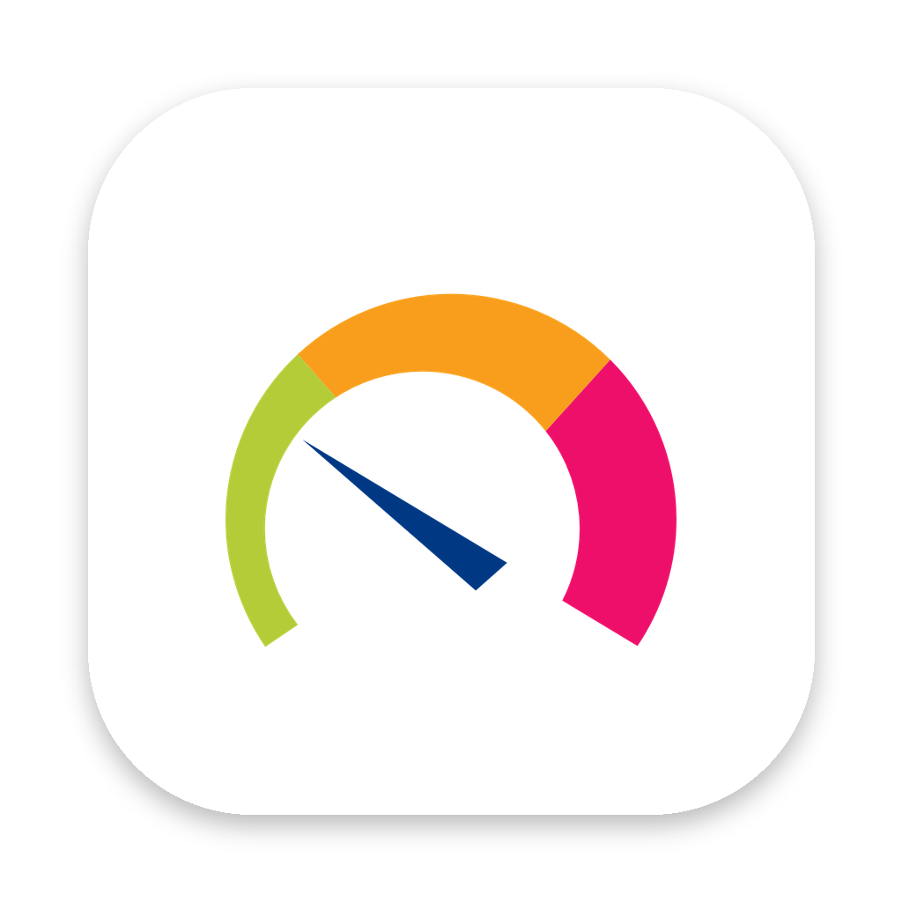
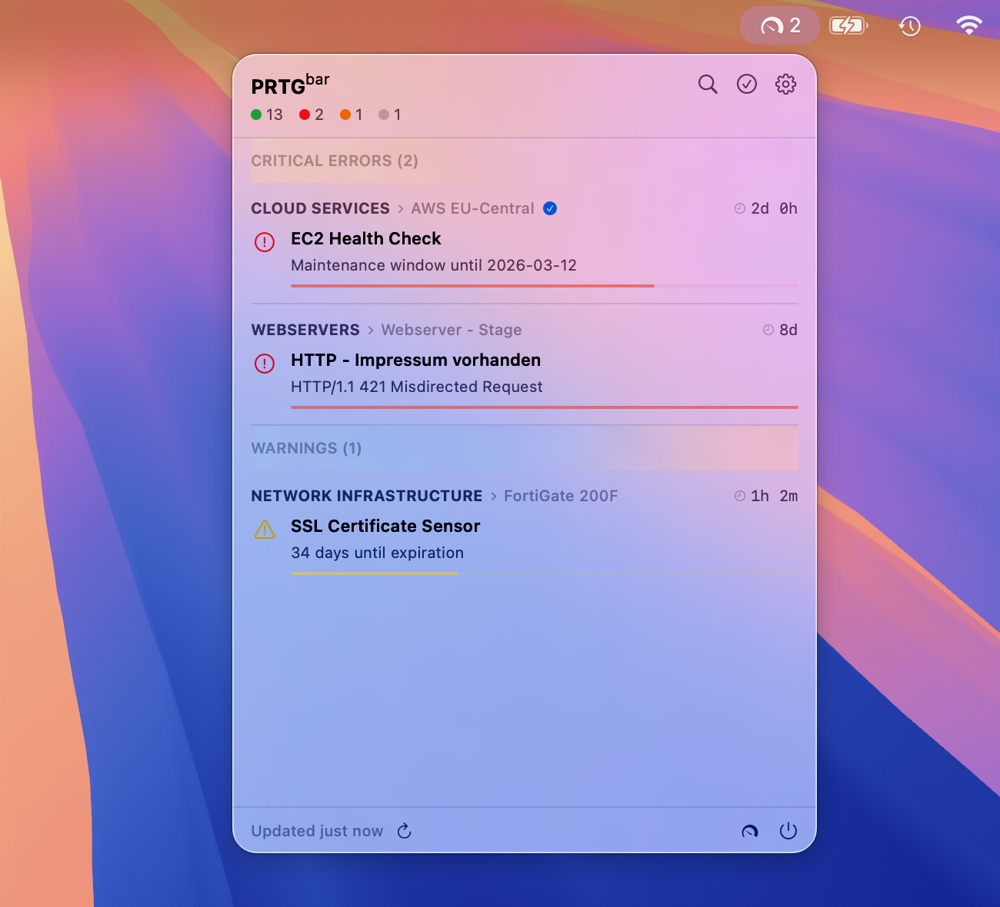

<div align="center">
  

# PRTG<sup>bar</sup>

**PRTG Network Monitor in your macOS menu bar.**

[Website](https://konradmichalik.github.io/prtgbar/) · [Releases](https://github.com/konradmichalik/prtgbar/releases)

[](https://www.apple.com/macos/)
[](https://swift.org)
[](https://developer.apple.com/xcode/)
[](LICENSE)

</div>

PRTGBar sits in your macOS menu bar and shows all down and warning sensors from your PRTG instance at a glance. Problems come first, projects sit one click away, and notifications stay calm.

<div align="center">
  
</div>

> [!NOTE]
> PRTGBar uses the **PRTG v1 REST API** (`/api/table.json`) with an API token for authentication. PRTG 22+ with API access enabled is required.

---

## ✨ Features

- **Native menu** with problems grouped by project and device, then your projects with their devices and sensors. A project is a top-level group by default, or a second-level group (for example the customers inside a team group)
- **Sensor details** for every sensor, healthy ones included: last value, a 24 h history strip, uptime ratio and outage count, kept locally
- **Menu bar gauge** that turns orange or red and points its needle at the worst state, with the live count of down sensors and optionally of warnings
- **Calm notifications** grouped per device or group, with a wait before alerting, flapping mute, reminders and recovery messages
- **Acknowledge and Open in PRTG** straight from a down notification, and acknowledge or pause sensors from the menu
- **Snooze** notifications for one hour or until 08:00
- **Self-signed SSL** works with PRTG instances behind private certificates
- **Keychain storage** keeps the API key in the macOS Keychain

---

## 🔥 Installation

### Homebrew (recommended)

[](https://github.com/konradmichalik/homebrew-tap)
[](https://github.com/konradmichalik/homebrew-tap)

```sh
brew install konradmichalik/tap/prtgbar
```

> [!TIP]
> After installing via Homebrew, launch PRTGBar from Spotlight or Applications. On first launch, macOS may ask you to allow the app in **System Settings > Privacy & Security**.

### Upgrade

```sh
brew update && brew upgrade prtgbar
```

### Build from source

See [docs/DEVELOPMENT.md](docs/DEVELOPMENT.md).

---

## ⚙️ Setup

Open **Settings…** from the PRTGBar menu (or press `⌘,`) and configure your connection in the **Server** tab:

| Setting | Description |
|---------|-------------|
| **Server URL** | Your PRTG hostname or IP, e.g. `prtg.example.com`. HTTPS is assumed when no scheme is specified. |
| **API Key** | A PRTG API token. Stored in the macOS Keychain. |
| **Accept self-signed certificates** | Allow connections to PRTG instances with self-signed SSL certificates. Enabled by default. |

> [!WARNING]
> The API key needs permission to read sensors, devices, groups, and probes. A read-only key is enough for monitoring. Acknowledging and pausing sensors from the menu or a notification needs a key with write access.

### Generating a PRTG API Token

1. Log in to your PRTG instance.
2. Go to **Setup > My Account > API Keys**.
3. Create a new key with **Read** access, or **Read/Write** to acknowledge and pause sensors.
4. Paste the token into PRTGBar's **API Key** field.

Once saved, PRTGBar polls immediately — no restart required.

---

## 📜 License

MIT — see [LICENSE](LICENSE).
